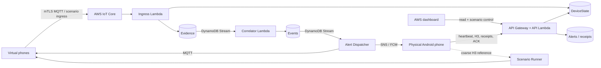
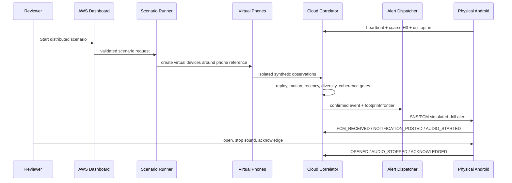

# QuakeMesh V2 academic review content package

This self-contained package is the authoritative source for updating an external report or presentation. No editable presentation, Word report, or PDF source was present in the repository during the final audit, so no external material is claimed as updated.

## 1. Problem statement

Individual smartphone motion can be caused by walking, handling, drops, vehicles, or sensor noise. A single threshold crossing is therefore insufficient for an earthquake-like event claim. QuakeMesh studies a cloud-native software approach that accepts device observations, converts location to privacy-reduced H3 cells, and confirms an experimental event only when recent evidence is diverse across devices and geographically coherent cells.

## 2. Objectives

- Build a reproducible smartphone/virtual-device motion-ingestion prototype.
- Prevent one device, replayed data, or a dense single-cell cluster from satisfying the event quorum.
- Represent contributing geography as an H3 Detection Footprint.
- Derive a surrounding Warning Frontier for demonstration alert targeting.
- Implement the same detector semantics in local and serverless AWS paths.
- Deliver a confirmed simulated drill wirelessly to an opted-in physical Android phone.
- Record delivery, opening, sound-stop, and acknowledgement state separately from event truth.
- Evaluate the production detector under controlled baseline, challenging synthetic, and recorded human-activity conditions.
- Provide exact-session ownership, observability, teardown, and CLEAN verification.

## 3. End-to-end architecture

### Component roles

| Component | Role |
|---|---|
| Virtual-phone fleet | Generates deterministic, separately identified scenario observations with optional loss, jitter, and propagation. |
| AWS IoT Core | Authenticates simulator Things using per-device X.509/mTLS and routes MQTT messages. |
| Ingress Lambda | Validates schemas, identity, clock bounds, replay state, motion gates, and H3 canonicalization. |
| DynamoDB | Stores device state, expiring evidence, events, alerts/receipts, and scenario runs/stages. |
| Correlator Lambda | Applies time, device-diversity, cell-diversity, and H3-coherence rules with conditional version writes. |
| Dispatcher Lambda | Makes retry-safe alert claims and publishes MQTT or SNS/FCM messages. |
| API Gateway/API Lambda | Serves dashboard reads, phone heartbeat/receipts/ACK, and scenario-control endpoints. |
| Android client | Reports physical heartbeat/H3, receives FCM, presents warnings, runs attention output, suppresses duplicates, and acknowledges. |
| React dashboard | Operates local/AWS scenarios and visualizes devices, events, footprint/frontier, stages, alerts, metrics, infrastructure, and session state. |

## 4. H3 geographical corroboration

Device latitude/longitude is accepted only at ingress, converted to H3, and not retained in the application device/evidence schema. Default detector values are:

| Parameter | Value |
|---|---:|
| Device H3 resolution | 9 |
| Correlation H3 resolution | 7 |
| Evidence window | 8 s |
| Minimum distinct devices | 4 |
| Minimum distinct coarse cells | 3 |
| Maximum cluster grid distance | 6 |
| Warning ring | k=1 |
| Event merge window | 20 s |
| Resolve inactivity | 30 s |
| RMS motion gate | 0.75 m/s² |
| Peak motion gate | 1.80 m/s² |

The **Detection Footprint** is the set of coarse H3 cells whose accepted evidence formed the corroborated component. The **Warning Frontier** is the configured H3 neighborhood around the footprint, excluding the footprint. Neither is an epicentre, seismic wavefront, magnitude contour, or arrival-time prediction.

## 5. Evidence and event flow

The phone's own physical evidence is never combined with a controlled scenario run. Provenance type and run ID partition physical and synthetic records.

## 6. Android integration

The Android client provides:

- foreground accelerometer/location monitoring and 30-second heartbeats;
- clear separation of local motion from cloud-corroborated events;
- explicit simulated-drill opt-in;
- FCM data-message parsing with stable `alert_id` identity;
- high-importance heads-up notification while unlocked/backgrounded;
- permitted full-screen warning presentation while locked/screen-off;
- dark-red labeled simulated-earthquake activity;
- alarm-category looping tone, spoken warning, vibration request, and bounded attention service;
- **STOP ALERT SOUND**, **ACKNOWLEDGE / DISMISS**, and **Dismiss** controls;
- cloud receipts and authoritative acknowledgement;
- stable duplicate suppression.

Observed unlocked behavior was a heads-up notification; tapping it opened the full warning. It was not an automatic unlocked-screen takeover. Locked-screen testing verified screen wake and full-screen warning over the keyguard when permission was allowed.

## 7. Interactive scenarios

| Scenario | Expected outcome | Research purpose |
|---|---|---|
| Isolated disturbance | No confirmation | Proves one device cannot confirm. |
| Same-cell cluster | No confirmation | Proves device count without coarse-cell diversity is insufficient. |
| Distributed corroboration | Confirmation | Exercises the intended positive spatial-temporal path. |
| Degraded network | Conditional | Measures whether sufficient evidence survives configured loss and jitter. |
| False-positive demonstration | No confirmation | Tests ordinary/uncorrelated or below-gate motion. |

The dashboard exposes accepted parameter ranges, authoritative run state, gate results, ordered stages, structured logs, run history, and map evolution. Scenario truth remains evaluator metadata and is never sent to the detector.

## 8. Experimental methodology

### Historical baseline

- 48 independently seeded deterministic trials.
- 12 each across isolated, same-cell, distributed, and degraded cases.
- Fresh SQLite database per trial.
- Production detector and real `h3-py` indexing.
- Ground truth assigned by scenario semantics before execution.
- One-to-one event matching; duplicate alerts do not become predictions.

### Expanded research benchmark

- 320 completed trials, 0 runner failures, including 60 pre-reserved held-out trials.
- 20 scenario types covering positives, negatives, confounders, network conditions, H3 boundaries, threshold boundaries, density, noise, replay, and participation.
- Designed sweeps across device counts, detector thresholds, evidence windows, packet loss, jitter, spatial distributions, and sensor noise.
- No threshold fitting to the held-out partition.
- Wilson confidence intervals for proportions; bootstrap intervals for appropriate latency measures.

### Recorded smartphone negative data

- UCI Human Activity Recognition Using Smartphones dataset.
- Authentic 50 Hz smartphone accelerometer windows from human activities.
- Original subject-disjoint train/test split retained.
- Production Android feature extraction and motion gate applied.
- Measures only the first-stage single-device motion gate, not multi-phone event accuracy.

### Live system validation

- Ephemeral exact-session AWS deployment in `ap-south-1`.
- Physical Motorola Edge 40 Neo registered heartbeat/H3 and opted in.
- USB disconnected before the final distributed scenario.
- Cloud receipts and acknowledgement queried while ADB remained absent.
- Positive, negative, degraded, duplicate-replay, unlocked, and locked-screen cases exercised.
- Exact-session STOP followed by inventory-backed and later fresh read-only CLEAN audits.

## 9. Results

### Classification results

| Evaluation | Trials | TP | TN | FP | FN | Accuracy | Precision | Recall | Specificity | F1 |
|---|---:|---:|---:|---:|---:|---:|---:|---:|---:|---:|
| Historical baseline | 48 | 24 | 24 | 0 | 0 | 1.0000 | 1.0000 | 1.0000 | 1.0000 | 1.0000 |
| Expanded benchmark | 320 | 86 | 151 | 25 | 58 | 0.7406 | 0.7748 | 0.5972 | 0.8580 | 0.6745 |
| Expanded held-out | 60 | 18 | 28 | 5 | 9 | 0.7667 | 0.7826 | 0.6667 | 0.8485 | 0.7200 |

The challenging benchmark deliberately includes failure-producing boundary conditions; its non-perfect results are more informative than the narrow baseline. Aggregate balanced accuracy was 0.7276 and MCC was 0.4758; held-out balanced accuracy was 0.7576 and MCC was 0.5271.

### Measured synthetic timing

| Dataset | Timing scope | Mean/average | Median/p50 | p95 |
|---|---|---:|---:|---:|
| Historical baseline | First injected trigger observation to confirmation | 513.75 ms | 469.5 ms | Not reported |
| Expanded benchmark | Injected event onset to local confirmation | 2355.83 ms | 1705.5 ms | 6653.25 ms |

Expanded matched synthetic onset timing error: MAE 278.26 ms, RMSE 1353.52 ms, median absolute error 0 ms, and p95 absolute error 420 ms. These are logical software-simulation timings, not AWS end-to-end latency or earthquake early-warning lead time.

### Recorded human-activity gate

The held-out partition contained 1,000 windows; 469 passed the local motion gate and 531 did not. The gate-positive rate was 0.4690 (95% Wilson interval 0.4382–0.5000). This does not mean a 46.9% earthquake-event false-alarm rate: cloud confirmation still requires independent devices, cells, time, and coherence.

### Final live scenarios

| Scenario | Expected | Observed | Accepted evidence |
|---|---|---|---:|
| Distributed, locked/screen off | Confirmation | Confirmation | 8 |
| Isolated shaking | No confirmation | No confirmation | 1 |
| Same-cell movement | No confirmation | No confirmation | 6 |
| False-positive motion | No confirmation | No confirmation | 0 |
| Degraded, 25% loss / 900 ms jitter | Conditional | Confirmation | 12 |
| Distributed, USB unplugged | Confirmation | Confirmation | 8 |

Final wireless receipts were `FCM_RECEIVED`, `NOTIFICATION_POSTED`, `AUDIO_STARTED`, `OPENED`, and `AUDIO_STOPPED`, followed by alert state `ACKNOWLEDGED` with source `android`. Replay left the alert at one delivery attempt.

## 10. Verification summary

- 109 Python tests passed in the final full validation.
- Ruff, JSON schemas/privacy audit, secret scan, and PowerShell launcher checks passed.
- Strict TypeScript, ESLint, seven Vitest tests, production Vite build, and three Playwright tests passed.
- Android `testDebugUnitTest`, `assembleDebug`, and `lintDebug` passed.
- CDK synthesis/deployment and the live AWS processing path passed.
- Final inventory-backed teardown and a fresh read-only audit returned `CLEAN`.
- The user personally confirmed the unlocked USB-disconnected heads-up, audible/spoken warning, tap-to-open warning, Stop Alert Sound, and acknowledgement sequence.

## 11. Technical limitations

- No real earthquake handset waveform ground truth is included; no real-world detection accuracy is claimed.
- The system does not estimate magnitude, epicentre, wave propagation, or warning lead time.
- Evaluation is controlled synthetic software behavior plus a separate human-activity gate study.
- Physical behavior was verified on one named Android handset, not a broad device/OS matrix.
- Formal TalkBack/accessibility, process-recreation, performance/load, and long-term reliability studies were not completed.
- The Android API key is a controlled-demo safeguard and is extractable from an APK; it is not production mobile authentication.
- Manual guarded STOP is the verified cleanup method; automatic expiry is not relied upon.
- Audible behavior under DND/silent mode and physical vibration strength are not part of the final scope.
- Serverless services and shared CDK assets can incur cost; CLEAN does not reverse prior charges.

## 12. Conclusion

QuakeMesh V2 demonstrates a complete academic cloud pipeline from controlled, geographically distributed virtual-device observations through real H3-based corroboration to an opted-in physical phone over SNS/FCM. The implementation correctly rejects the principal negative demonstrations, records provenance and delivery state separately, supports a reproducible Windows review workflow, and tears down exact-session AWS resources with a verifiable CLEAN result. Its contribution is a transparent, testable systems prototype—not a claim of production earthquake warning capability.

## 13. Future scope

- Licensed raw earthquake smartphone waveform evaluation.
- Multi-handset, multi-OS, accessibility, and process-recreation testing.
- Calibrated probabilistic scoring and domain-expert threshold validation.
- Partitioned scale-out correlator and controlled load/cost study.
- Production-grade device identity/authentication and key rotation.
- Separately verified automatic-expiry behavior while retaining guarded manual teardown.

## 14. Suggested concise presentation sequence

1. Problem and safety scope.
2. Architecture/data-flow diagram.
3. H3 footprint/frontier and quorum rules.
4. Local dashboard negative/positive behavior.
5. AWS dashboard Scenario Lab and live cloud resources.
6. USB-disconnected Android alert and acknowledgement.
7. Baseline versus challenging benchmark table.
8. Limitations, conclusion, and CLEAN teardown proof.

Use normal fonts, one technical diagram or result table per slide, and no decorative claims beyond the recorded evidence.
